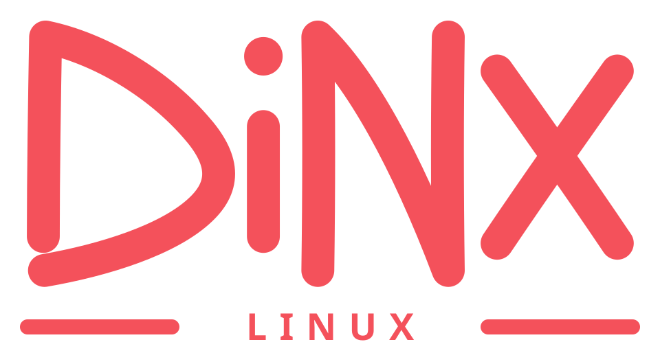

<h1 align="center">
  
</h1>

<p align="center">
  <strong>Artix Linux + dinit, with a lean, simple, easy-to-use Wayland desktop.</strong><br>
  A public alpha for testing the base system, its limits and the installation path — without hiding what is unfinished.
</p>

<p align="center">
  🌐 <strong>English</strong> ·
  <a href="README.md"><strong>Leia em Português (Brasil)</strong></a> — the main page is in Portuguese; click to open it.
</p>

<p align="center">
  <a href="https://github.com/rufl/DINX/releases/download/alpha-latest/dinx-latest-x86_64.iso"></a>
  <a href="https://github.com/rufl/DINX/releases"></a>
  <a href="https://github.com/rufl/DINX/actions/workflows/p0-iso.yml"></a>
  <a href="docs/licensing.md"></a>
  <a href="LICENSE"></a>
</p>

> **Public alpha software.** Back up your data before testing. The live ISO and installer are experimental; a successful boot is not a hardware qualification.

## Start here

| If you want to… | Go to |
|---|---|
| Download the latest direct ISO | [Direct ISO](https://github.com/rufl/DINX/releases/download/alpha-latest/dinx-latest-x86_64.iso) · [SHA-512](https://github.com/rufl/DINX/releases/download/alpha-latest/dinx-latest-x86_64.iso.sha512) · [All releases](https://github.com/rufl/DINX/releases) |
| Verify and install the ISO | [Installation guide](docs/install.md) |
| See what CI actually proved | [P0 build status](docs/p0-build.md) |
| Understand compatibility and limits | [Compatibility](docs/compatibility.md) · [Roadmap](docs/roadmap.md) |
| Read the release process | [Alpha release](docs/release.md) |
| Check licensing and REUSE coverage | [Licensing](docs/licensing.md) |
| Read in Portuguese | [README em Português](README.md) |

## Official branches

| Branch | Role |
|---|---|
| [`main`](https://github.com/rufl/DINX/tree/main) | Linux distribution: ISO, packages, desktop, qualification and releases |
| [`feat/bsd`](https://github.com/rufl/DINX/tree/feat/bsd) | DINX FreeBSD variant (no CEF/EuroOffice; office via native apps/browser) |
| [`office`](https://github.com/rufl/DINX/tree/office) | EuroOffice pipeline: lean upstream repack, `eurooffice/v*` release publication |
| [`themes`](https://github.com/rufl/DINX/tree/themes) | Theme ports (Skeuos/Orchis) to Pearl's community theme format and GTK |
| [`tools`](https://github.com/rufl/DINX/tree/tools) | Auxiliary build, qualification and launcher tooling |

`main` consumes the lean EuroOffice releases published by the `office` branch (pin + SHA256 verification + rootfs/livefs merge); branches are not merged into each other without review.

## In brief

DINX is an Artix distribution for a small, legible and controllable desktop session:

- **Artix Linux + dinit** as the base, without replacing the init system with systemd;
- **Aqueous + Pearl** as the only user session, started directly over dinit; **Pearl Greeter** is the greetd login UI;
- **DinitUI** and **DINXPanel** (system control center) for service, hardware, driver and kernel profiles;
- **Calamares** for experimental installation, **GParted** for separate partition editing and **Pori** for persistent disks and mounts through dinit;
- **Phyto** as the default file manager and **File Roller** for archives;
- **Firefox** (Artix package) as the browser and default HTML/HTTP/HTTPS handler;
- **EuroOffice** as the office and PDF suite (documents, spreadsheets, presentations; default `application/pdf` and OOXML handler), consumed from the `office` branch's lean `eurooffice/v*` releases;
- **PaintFE** (Rust raster editor), **Krita**, **Inkscape**, **Godot**, **Pixelorama**, **Patchy** and **Blockbench** for creation; **Transit** as the digital audio workstation; **Zenkai** as the application launcher;
- **Haruna** (video) and **Gapless** (music) with GStreamer codecs; **Swayimg** as the image viewer;
- **wdisplays + Shikane** for configuring Wayland displays and reapplying the layout across sessions;
- the kernel **ntfs3** module for NTFS read/write support in the live ISO and installed system;
- **Mesa/RADV and VM graphics:** qualification on default VGA and Virtio-VGA in QEMU; direct VirtualBox boot still needs qualification. See the [install guide](docs/install.md);
- **DINX Gaming** keeps its manual launcher hidden; the gaming stack (Gamescope, Steam, GameMode, MangoHud, 32-bit) is opt-in after installation.

Upstream binary apps (PaintFE, Transit, Zenkai, Patchy, Blockbench) are **repacked as pre-extracted `/opt/<package>/` trees** at build time (`scripts/lib/repack-appimage.sh`): ELF stripped where safe, locales trimmed to en/pt, and launchers exec `AppRun` directly — no FUSE and no per-launch tmpfs extraction. The final SquashFS uses **xz + x86 BCJ, 1 MiB blocks and dictionary** to keep the direct ISO below GitHub's 2 GiB per-asset limit.

`dinx-doctor` produces a read-only report of the session, dinit, storage/display paths and DINX packages. It does not start services, mount devices, perform package transactions or access the network.

BC-250 software is not installed in the generic ISO; its packages are in the signed DINX repository and should only be installed after confirming PCI ID `1002:13fe`.

## Current state

| Item | Status |
|---|---|
| Direct ISO (rolling alias) | [`dinx-latest-x86_64.iso`](https://github.com/rufl/DINX/releases/download/alpha-latest/dinx-latest-x86_64.iso), 1,836,830,720 bytes, with [SHA-512](https://github.com/rufl/DINX/releases/download/alpha-latest/dinx-latest-x86_64.iso.sha512) |
| Most recent releases | [Alpha 0.14](https://github.com/rufl/DINX/releases/tag/v0.1.0-alpha.14) and [Alpha 0.15](https://github.com/rufl/DINX/releases/tag/v0.1.0-alpha.15) (split ISO parts, above the 2 GiB limit) |
| Next ISO | Alpha with **EuroOffice** in P0 qualification; will be published as a direct ISO only if it stays below 2 GiB |
| Base | Artix Linux x86_64 with dinit |
| Next milestone | System Beta 0.1: planned, not released, and undated |
| Gaming qualification | Separate P5 track; not complete |

The [GitHub release-asset limit](https://docs.github.com/en/repositories/releasing-projects-on-github/about-releases) is **2 GiB** (`2,147,483,648` bytes). ISOs above it use the split delivery (`.iso.part-*` + `.iso.parts.json`); the rolling direct-ISO alias only advances when a release qualifies with a single image below the limit. [Full criteria in the roadmap](docs/roadmap.md).

## Quick install

1. Download the [latest direct ISO](https://github.com/rufl/DINX/releases/download/alpha-latest/dinx-latest-x86_64.iso) and its [SHA-512 file](https://github.com/rufl/DINX/releases/download/alpha-latest/dinx-latest-x86_64.iso.sha512).
2. In the same directory, verify the file:

   ```bash
   sha512sum -c dinx-latest-x86_64.iso.sha512
   ```

3. Write the verified ISO to the whole USB device — not a partition — and boot in UEFI mode.
4. The live image opens directly in `Aqueous + Pearl (DINX)`; it does not request a username or password. Installed login and Calamares autologin remain disabled.

Read the [installation guide](docs/install.md) before touching a disk. Windows Fast Startup and hibernation must be disabled before mounting a shared NTFS volume.

## Automation

Five independent, concurrency-controlled automations (details in [Automation](docs/automation.md)):

- **Upstream prefetch** (`upstream-cache-prefetch.yml`, 04:17/16:17 UTC): verified delta cache of Artix packages;
- **Source refresh** (`upstream-package-refresh.yml`, 03:17 UTC): checksum-pinned updates (SHA-256 64 hex / BLAKE2b 128 hex) opened as PRs;
- **Dependency audit** (`security-scan.yml`, 01:17 UTC + PR/push): SPDX SBOM + Grype/Trivy/OSV;
- **Nightly ISO** (`p0-iso.yml`, 02:17 UTC): build + P0 gates + QEMU boot + disposable installation;
- **EuroOffice refresh** (`eurooffice-refresh.yml`, every 3 days): dispatches the `office` branch pipeline, verifies `SHA256SUMS`, commits the pin and dispatches P0.

## Evidence and limits

| Current qualification covers | Not claimed yet |
|---|---|
| x86_64 boot and graphical payload in QEMU | Physical hardware matrix |
| Calamares BIOS/UEFI/Btrfs partition contracts | Secure Boot |
| Disposable BIOS/UEFI installation, dinit first boot and recovery TTY | Authenticated Steam, commercial game, controller and PipeWire audio |
| Compact ISO, checksums, metadata, attestation and signed repository | Suspend/resume, GPU recovery and installed-ISO upgrade/rollback |

## REUSE and licensing

**This repository is compliant with the [REUSE Specification 3.3](https://reuse.software/).** `reuse lint` passes with no errors: every file carries SPDX copyright and license information (`REUSE.toml` + texts in `LICENSES/`). DINX-owned entries are Apache-2.0; upstream components keep their own licenses (MIT, GPL-3.0-only, OFL-1.1-no-RFN, among others) declared per file.

- [Licensing and REUSE](docs/licensing.md)
- [GitHub source](https://github.com/rufl/DINX) · [Issues](https://github.com/rufl/DINX/issues) · [Releases](https://github.com/rufl/DINX/releases)
- [Validation workflow](https://github.com/rufl/DINX/actions/workflows/p0-iso.yml)

## Documentation

- [Architecture](docs/architecture.md)
- [Installation guide](docs/install.md)
- [DINX compatibility](docs/compatibility.md)
- [P0 build status](docs/p0-build.md)
- [Roadmap](docs/roadmap.md)
- [Release process](docs/release.md)
- [Hardware qualification](docs/alpha7-qualification.md)
- [ISO foundation](distro/iso/README.md)
- [Security model](docs/security-model.md)
- [Package, security and ISO automation](docs/automation.md)
- [Licensing and REUSE](docs/licensing.md)
- [Changelog](CHANGELOG.md)
