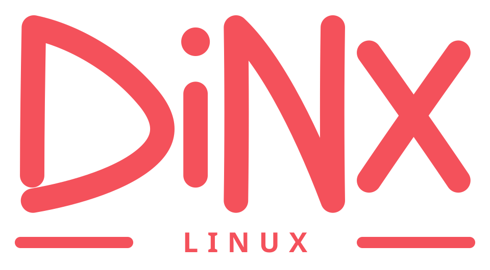

<h1 align="center">
  
</h1>

<p align="center">
  <strong>Artix Linux + dinit, com um desktop Wayland enxuto, simples e fácil de usar.</strong><br>
  Um alpha público para testar a base, os limites e o caminho de instalação — sem esconder o que ainda falta.
</p>

<p align="center">
  🌐 <strong>Português (Brasil)</strong> (página principal) ·
  <a href="README.en.md"><strong>Read in English</strong></a> — não fala português? Clique para abrir a versão em inglês.
</p>

<p align="center">
  <a href="https://github.com/rufl/DINX/releases/download/alpha-latest/dinx-latest-x86_64.iso"></a>
  <a href="https://github.com/rufl/DINX/releases"></a>
  <a href="https://github.com/rufl/DINX/actions/workflows/p0-iso.yml"></a>
  <a href="docs/pt-BR/licensing.md"></a>
  <a href="LICENSE"></a>
</p>

> **Software alpha público.** Faça backup antes de testar. A ISO live e o instalador são experimentais; um boot bem-sucedido não é uma qualificação de hardware.

## Comece aqui

| Você quer… | Vá para |
|---|---|
| Baixar a ISO direta mais recente | [ISO direta](https://github.com/rufl/DINX/releases/download/alpha-latest/dinx-latest-x86_64.iso) · [SHA-512](https://github.com/rufl/DINX/releases/download/alpha-latest/dinx-latest-x86_64.iso.sha512) · [Todas as releases](https://github.com/rufl/DINX/releases) |
| Verificar e instalar a ISO | [Guia de instalação](docs/pt-BR/install.md) |
| Ver o que o CI realmente provou | [Status do build P0](docs/pt-BR/p0-build.md) |
| Entender compatibilidade e limites | [Compatibilidade](docs/pt-BR/compatibility.md) · [Roadmap](docs/pt-BR/roadmap.md) |
| Ler o processo de release | [Release alpha](docs/pt-BR/release.md) |
| Consultar a licença e o REUSE | [Licenciamento](docs/pt-BR/licensing.md) |
| Ler em inglês | [README in English](README.en.md) |

## Branches oficiais

| Branch | Papel |
|---|---|
| [`main`](https://github.com/rufl/DINX/tree/main) | Distribuição Linux: ISO, pacotes, desktop, qualificação e releases |
| [`feat/bsd`](https://github.com/rufl/DINX/tree/feat/bsd) | Variante FreeBSD da DINX (sem CEF/EuroOffice; escritório via apps nativos/browser) |
| [`office`](https://github.com/rufl/DINX/tree/office) | Pipeline do EuroOffice: repack lean do upstream, publicação de releases `eurooffice/v*` |
| [`themes`](https://github.com/rufl/DINX/tree/themes) | Ports de temas (Skeuos/Orchis) para o formato de temas do Pearl e GTK |
| [`tools`](https://github.com/rufl/DINX/tree/tools) | Tooling auxiliar de build, qualificação e lançamento |

A `main` consome os releases lean do EuroOffice publicados pela branch `office` (pin + verificação SHA256 + merge no rootfs/livefs); as branches não são mergeadas entre si sem revisão.

## Em resumo

DINX é uma distribuição Artix para uma sessão gráfica pequena, legível e controlável:

- **Artix Linux + dinit** como base, sem trocar o init por systemd;
- **Aqueous + Pearl** como a única sessão do usuário, iniciada diretamente sobre dinit; o **Pearl Greeter** é a interface de login do greetd;
- **DinitUI** e **DINXPanel** (Central de Controle) para perfis de serviços, hardware, drivers e kernels;
- **Calamares** para a instalação experimental, **GParted** para particionamento separado e **Pori** para discos e montagens persistentes via dinit;
- **Phyto** como gerenciador de arquivos padrão e **File Roller** para arquivos compactados;
- **Firefox** (pacote Artix) como navegador e handler padrão de HTML/HTTP/HTTPS;
- **EuroOffice** como suíte de escritório e PDF (documentos, planilhas, apresentações; handler padrão de `application/pdf` e OOXML), consumido dos releases lean `eurooffice/v*` da branch `office`;
- **PaintFE** (editor raster em Rust), **Krita**, **Inkscape**, **Godot**, **Pixelorama**, **Patchy** e **Blockbench** para criação; **Transit** como estação de áudio digital; **Zenkai** como lançador de aplicativos;
- **Haruna** (vídeo) e **Gapless** (música) com codecs GStreamer; **Swayimg** como visualizador de imagens;
- **wdisplays + Shikane** para configurar displays Wayland e reaplicar o layout entre sessões;
- o módulo de kernel **ntfs3** para leitura e escrita NTFS na ISO live e no sistema instalado;
- **Mesa/RADV e gráficos em VM:** qualificação em VGA padrão e Virtio-VGA do QEMU; boot direto no VirtualBox ainda precisa de qualificação. Veja o [guia de instalação](docs/pt-BR/install.md);
- **DINX Gaming** mantém o launcher manual oculto; o conjunto gaming (Gamescope, Steam, GameMode, MangoHud, 32 bits) é opcional após a instalação.

Apps binários upstream (PaintFE, Transit, Zenkai, Patchy, Blockbench) são **reempacotados como árvores `/opt/<pacote>/` pré-extraídas** no build (`scripts/lib/repack-appimage.sh`): strip de ELF onde seguro, locales reduzidos a en/pt e launchers que executam `AppRun` diretamente — sem FUSE e sem extração em tmpfs a cada inicialização. O SquashFS final usa **xz + BCJ x86, blocos e dicionário de 1 MiB** para manter a ISO direta abaixo do limite de 2 GiB por asset do GitHub.

`dinx-doctor` produz um relatório somente leitura da sessão, do dinit, dos caminhos de armazenamento/display e dos pacotes DINX. Ele não inicia serviços, monta dispositivos, executa transações de pacotes nem acessa a rede.

O software BC-250 não é instalado na ISO genérica; os pacotes estão no repositório DINX assinado e só devem ser instalados após confirmar o PCI `1002:13fe`.

## Estado atual

| Item | Estado |
|---|---|
| ISO direta (alias rolante) | [`dinx-latest-x86_64.iso`](https://github.com/rufl/DINX/releases/download/alpha-latest/dinx-latest-x86_64.iso), 1.836.830.720 bytes, com [SHA-512](https://github.com/rufl/DINX/releases/download/alpha-latest/dinx-latest-x86_64.iso.sha512) |
| Releases mais recentes | [Alpha 0.14](https://github.com/rufl/DINX/releases/tag/v0.1.0-alpha.14) e [Alpha 0.15](https://github.com/rufl/DINX/releases/tag/v0.1.0-alpha.15) (ISO dividida em partes, acima do limite de 2 GiB) |
| Próxima ISO | Alpha com **EuroOffice** em qualificação P0; será publicada como ISO direta somente se ficar abaixo de 2 GiB |
| Base | Artix Linux x86_64 com dinit |
| Próximo marco | Beta 0.1 do sistema: planejada, ainda não publicada e sem data |
| Qualificação gaming | P5 separada da beta do sistema; ainda não concluída |

O [limite por arquivo de release do GitHub](https://docs.github.com/en/repositories/releasing-projects-on-github/about-releases) é **2 GiB** (`2.147.483.648` bytes). ISOs acima dele usam a entrega dividida (`.iso.part-*` + `.iso.parts.json`); o alias rolante de ISO direta só avança quando uma release qualifica com imagem única abaixo do limite. [Critérios completos no roadmap](docs/pt-BR/roadmap.md).

## Instalação rápida

1. Baixe a [ISO direta mais recente](https://github.com/rufl/DINX/releases/download/alpha-latest/dinx-latest-x86_64.iso) e seu [arquivo SHA-512](https://github.com/rufl/DINX/releases/download/alpha-latest/dinx-latest-x86_64.iso.sha512).
2. No mesmo diretório, verifique o arquivo:

   ```bash
   sha512sum -c dinx-latest-x86_64.iso.sha512
   ```

3. Grave a ISO verificada no dispositivo USB inteiro — não em uma partição — e inicialize em UEFI.
4. A imagem live abre diretamente em `Aqueous + Pearl (DINX)`; ela não solicita usuário ou senha. O login instalado e o autologin do Calamares continuam desativados.

Leia o [guia de instalação](docs/pt-BR/install.md) antes de tocar em qualquer disco. Windows Fast Startup e hibernação devem estar desativados antes de montar um volume NTFS compartilhado.

## Automação

Cinco automações independentes com concorrência controlada (detalhes em [Automação](docs/pt-BR/automation.md)):

- **Prefetch upstream** (`upstream-cache-prefetch.yml`, 04:17/16:17 UTC): cache delta verificada de pacotes Artix;
- **Renovação de fontes** (`upstream-package-refresh.yml`, 03:17 UTC): pins checksumados (SHA-256 64 hex / BLAKE2b 128 hex) abertos como PR;
- **Auditoria de dependências** (`security-scan.yml`, 01:17 UTC + PR/push): SBOM SPDX + Grype/Trivy/OSV;
- **ISO noturna** (`p0-iso.yml`, 02:17 UTC): build + gates P0 + boot QEMU + instalação descartável;
- **Renovação do EuroOffice** (`eurooffice-refresh.yml`, a cada 3 dias): dispara o pipeline da branch `office`, verifica `SHA256SUMS`, fixa o pin e dispara o P0.

## Evidência e limites

| A qualificação atual cobre | Ainda não é alegado |
|---|---|
| Boot x86_64 e payload gráfico em QEMU | Matriz de hardware físico |
| Contratos de particionamento Calamares BIOS/UEFI/Btrfs | Secure Boot |
| Instalação descartável BIOS/UEFI, primeiro boot dinit e TTY de recuperação | Steam autenticado, jogo comercial, controle e áudio PipeWire |
| ISO compacta, checksums, metadados, atestação e repositório assinado | Suspensão/retomada, recuperação de GPU e upgrade/rollback da ISO instalada |

## REUSE e licenciamento

**Este repositório é compliant com a [REUSE Specification 3.3](https://reuse.software/).** `reuse lint` passa sem erros: todos os arquivos carregam copyright e licença SPDX (`REUSE.toml` + textos em `LICENSES/`). As entradas próprias da DINX são Apache-2.0; componentes upstream mantêm suas licenças (MIT, GPL-3.0-only, OFL-1.1-no-RFN, entre outras) declaradas por arquivo.

- [Licenciamento e REUSE](docs/pt-BR/licensing.md)
- [Código no GitHub](https://github.com/rufl/DINX) · [Issues](https://github.com/rufl/DINX/issues) · [Releases](https://github.com/rufl/DINX/releases)
- [Workflow de validação](https://github.com/rufl/DINX/actions/workflows/p0-iso.yml)

## Documentação

- [Arquitetura](docs/pt-BR/architecture.md)
- [Guia de instalação](docs/pt-BR/install.md)
- [Compatibilidade DINX](docs/pt-BR/compatibility.md)
- [Status do build P0](docs/pt-BR/p0-build.md)
- [Roadmap](docs/pt-BR/roadmap.md)
- [Processo de release](docs/pt-BR/release.md)
- [Qualificação de hardware](docs/pt-BR/alpha7-qualification.md)
- [Fundação da ISO](distro/iso/README.pt-BR.md)
- [Modelo de segurança](docs/pt-BR/security-model.md)
- [Automação de pacotes, segurança e ISO](docs/pt-BR/automation.md)
- [Licenciamento e REUSE](docs/pt-BR/licensing.md)
- [Changelog](CHANGELOG.pt-BR.md)
