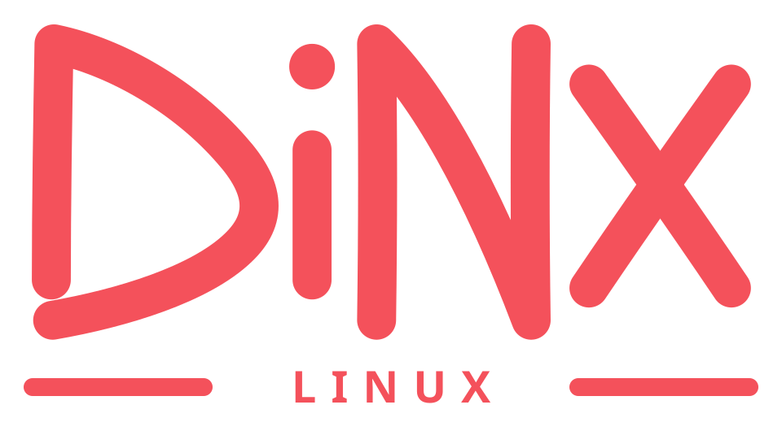

<p align="center">
  
</p>

<h1 align="center">DINX</h1>

<p align="center">
  <strong>Artix Linux + dinit, com um desktop Wayland enxuto e explícito.</strong><br>
  Um alpha público para testar a base, os limites e o caminho de instalação — sem esconder o que ainda falta.
</p>

<p align="center">
  <a href="README.md">Português (Brasil)</a> ·
  <a href="README.en.md">English</a>
</p>

<p align="center">
  <a href="https://github.com/rufl/DINX/releases/tag/v0.1.0-alpha.9"></a>
  <a href="https://github.com/rufl/DINX/actions/workflows/p0-iso.yml"></a>
  
  <a href="LICENSE"></a>
</p>

> **Software alpha público.** Faça backup antes de testar. A ISO live e o instalador são experimentais; um boot bem-sucedido não é uma qualificação de hardware.

## Comece aqui

| Você quer… | Vá para |
|---|---|
| Baixar a imagem publicada | [DINX v0.1.0-alpha.9](https://github.com/rufl/DINX/releases/tag/v0.1.0-alpha.9) |
| Verificar e instalar a ISO | [Guia de instalação](docs/pt-BR/install.md) |
| Ver o que o CI realmente provou | [Status do build P0](docs/pt-BR/p0-build.md) |
| Entender compatibilidade e limites | [Compatibilidade](docs/pt-BR/compatibility.md) · [Roadmap](docs/pt-BR/roadmap.md) |
| Ler o processo de release | [Release alpha](docs/pt-BR/release.md) |
| Consultar a licença e o REUSE | [Licenciamento](docs/pt-BR/licensing.md) |
| Ler em inglês | [README em inglês](README.en.md) |

## Em resumo

DINX é uma distribuição Artix para uma sessão gráfica pequena, legível e controlável:

- **Artix Linux + dinit** como base, sem trocar o init por systemd;
- **labwc + Noctalia** como a sessão suportada;
- **DinitUI** e **DINXPanel** para perfis de serviços, hardware, drivers e kernels;
- **Calamares** para a instalação experimental, **GParted** para particionamento separado e **Pori** para discos e montagens persistentes via dinit;
- **Phyto** como gerenciador de arquivos padrão e **File Roller** para abrir, criar e extrair arquivos compactados;
- **wdisplays + Shikane** para configurar displays Wayland e reaplicar o layout entre sessões;
- o módulo de kernel **ntfs3** para leitura e escrita NTFS na ISO live e no sistema instalado;
- uma sessão **DINX Gaming** separada, com Gamescope, Steam e bibliotecas gráficas de 32 bits.

`dinx-doctor` produz um relatório somente leitura da sessão, do dinit, dos caminhos de armazenamento/display e dos pacotes DINX. Defina `DINX_DOCTOR_QUERY_DINIT=1` somente quando também quiser consultar o socket do dinit do usuário. Ele não inicia serviços, monta dispositivos, executa transações de pacotes nem acessa a rede.

## Seafoam na ISO base

**Dome**, **Seafoam Settings** e **ZLS 0.16.0** fazem parte da ISO base e do repositório DINX assinado. Dome oferece monitoramento de recursos/processos sem instalar ou exigir systemd; Seafoam Settings agrupa os pontos de entrada de display e sessão; ZLS fornece LSP para Zig no Nocted com a biblioteca padrão Zig correspondente e um shim de metadados compacto, sem exigir um compilador Zig completo na ISO.

## O que fica fora da ISO base

**Aqueous** e **Pearl** continuam planejados como uma opção alternativa em Zig. O empacotamento upstream exige `uwsm` e unidades systemd de usuário; a DINX não instala systemd nem expõe essas sessões no greeter. Labwc + Noctalia continua sendo o caminho suportado, sem fallback silencioso.

## Estado atual

| Item | Estado |
|---|---|
| Release publicado | `v0.1.0-alpha.9`, ISO direta de 2.008.801.280 bytes |
| Base | Artix Linux x86_64 com dinit |
| Fase | P5 — beta de jogos; P4 DinitUI qualificada para o gate alpha |
| Validação da release | [Workflow 39924316082](https://github.com/rufl/DINX/actions/runs/39924316082) |
| Validação mais recente da `main` | [Workflow 39934458077](https://github.com/rufl/DINX/actions/runs/39934458077), verde após build, boot, payload gráfico, BIOS/UEFI, TTY, atestação e upload |

A release Alpha 9 publica a ISO, checksum SHA-512, metadados, evidências QEMU e o repositório de pacotes DINX assinado. A validação da `main` não cria uma nova release; ela confirma que os contratos continuam verdes depois do snapshot publicado. A mudança de autologin live da `main` vale para o próximo build da ISO; ela não altera retroativamente o artefato Alpha 9 já publicado.

## Instalação rápida

1. Baixe a ISO e o arquivo `.iso.sha512` da [release Alpha 9](https://github.com/rufl/DINX/releases/tag/v0.1.0-alpha.9).
2. No mesmo diretório, verifique o arquivo:

   ```bash
   sha512sum -c dinx-0.1.0-alpha.9-x86_64.iso.sha512
   ```

3. Grave a ISO verificada no dispositivo USB inteiro — não em uma partição — e inicialize em UEFI.
4. A imagem Alpha 9 publicada segue o snapshot do release. A próxima ISO compilada da `main` abrirá diretamente em `Labwc (DINX)`; nenhum usuário ou senha será solicitado.

Leia o [guia de instalação](docs/pt-BR/install.md) antes de tocar em qualquer disco. Windows Fast Startup e hibernação devem estar desativados antes de montar um volume NTFS compartilhado.

## Evidência e limites

| A qualificação atual cobre | Ainda não é alegado |
|---|---|
| Boot x86_64 e payload gráfico em QEMU | Matriz de hardware físico |
| Contratos de particionamento Calamares BIOS/UEFI/Btrfs | Secure Boot |
| Instalação descartável BIOS/UEFI, primeiro boot dinit e TTY de recuperação | Steam autenticado, jogo comercial, controle e áudio PipeWire |
| ISO compacta, checksums, metadados, atestação e repositório assinado | Suspensão/retomada, recuperação de GPU e upgrade/rollback da ISO instalada |

## Documentação

- [Arquitetura](docs/pt-BR/architecture.md)
- [Guia de instalação](docs/pt-BR/install.md)
- [Compatibilidade com Noctalia](docs/pt-BR/compatibility.md)
- [Status do build P0](docs/pt-BR/p0-build.md)
- [Roadmap](docs/pt-BR/roadmap.md)
- [Processo de release](docs/pt-BR/release.md)
- [Qualificação de hardware](docs/pt-BR/alpha7-qualification.md)
- [Fundação da ISO](distro/iso/README.pt-BR.md)
- [Modelo de segurança](docs/pt-BR/security-model.md)
- [Licenciamento e REUSE](docs/pt-BR/licensing.md)
- [Changelog](CHANGELOG.pt-BR.md)

## Código, contratos e licença

Este repositório mantém juntos o perfil da ISO, os pacotes, as integrações do desktop, os checks de qualificação e o tooling de release. As entradas específicas da DINX são licenciadas sob Apache-2.0. O archive versionado do Noctty é uma fonte upstream separada sob MIT; a cobertura está declarada em `REUSE.toml` e os textos estão em `LICENSES/`.

- [Código no GitHub](https://github.com/rufl/DINX)
- [Issues](https://github.com/rufl/DINX/issues)
- [Releases](https://github.com/rufl/DINX/releases)
- [Workflow de validação](https://github.com/rufl/DINX/actions/workflows/p0-iso.yml)
