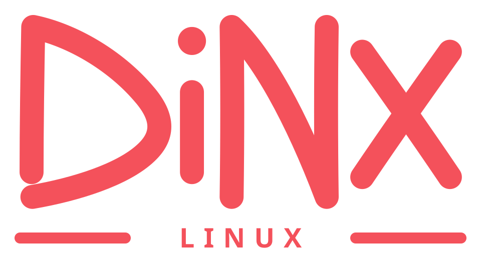

<h1 align="center">
  
</h1>

<p align="center">
  <strong>Artix Linux + dinit, com um desktop Wayland enxuto, simples e fácil de usar.</strong><br>
  Um alpha público para testar a base, os limites e o caminho de instalação — sem esconder o que ainda falta.
</p>

<p align="center">
  <a href="README.md">Português (Brasil)</a> ·
  <a href="README.en.md">English</a>
</p>

<p align="center">
  <a href="https://github.com/rufl/DINX/releases/download/alpha-latest/dinx-latest-x86_64.iso"></a>
  <a href="https://github.com/rufl/DINX/releases/tag/alpha-latest"></a>
  <a href="https://github.com/rufl/DINX/actions/workflows/p0-iso.yml"></a>
  
  <a href="LICENSE"></a>
</p>

> **Software alpha público.** Faça backup antes de testar. A ISO live e o instalador são experimentais; um boot bem-sucedido não é uma qualificação de hardware.

## Comece aqui

| Você quer… | Vá para |
|---|---|
| Baixar a ISO alpha mais recente | [ISO direta](https://github.com/rufl/DINX/releases/download/alpha-latest/dinx-latest-x86_64.iso) · [SHA-512](https://github.com/rufl/DINX/releases/download/alpha-latest/dinx-latest-x86_64.iso.sha512) · [Release Alpha 0.12](https://github.com/rufl/DINX/releases/tag/v0.1.0-alpha.12) · [Outras releases](https://github.com/rufl/DINX/releases) |
| Verificar e instalar a ISO | [Guia de instalação](docs/pt-BR/install.md) |
| Ver o que o CI realmente provou | [Status do build P0](docs/pt-BR/p0-build.md) |
| Entender compatibilidade e limites | [Compatibilidade](docs/pt-BR/compatibility.md) · [Roadmap](docs/pt-BR/roadmap.md) |
| Ler o processo de release | [Release alpha](docs/pt-BR/release.md) |
| Consultar a licença e o REUSE | [Licenciamento](docs/pt-BR/licensing.md) |
| Ler em inglês | [README em inglês](README.en.md) |

## Em resumo

DINX é uma distribuição Artix para uma sessão gráfica pequena, legível e controlável:

- **Artix Linux + dinit** como base, sem trocar o init por systemd;
- **River + KWM + Morghulis** como sessão Wayland da base, iniciada diretamente sobre dinit; `greetd` usa `agreety` para login;
- **DinitUI** e **DINXPanel** para perfis de serviços, hardware, drivers e kernels;
- **Calamares** para a instalação experimental, **GParted** para particionamento separado e **Pori** para discos e montagens persistentes via dinit;
- **PCManFM** como gerenciador de arquivos e desktop padrão, com **File Roller** para abrir, criar e extrair arquivos compactados;
- **wdisplays + Shikane** para configurar displays Wayland e reaplicar o layout entre sessões;
- o módulo de kernel **ntfs3** para leitura e escrita NTFS na ISO live e no sistema instalado;
- **Mesa/RADV e gráficos em VM:** o builder inclui `vmwgfx`/`vboxvideo` no initramfs e o checker valida ambos na ISO. A qualificação testa a sessão no VGA padrão e Virtio-VGA do QEMU. No host usado, QEMU 11.1.2/KVM com `vmware-svga` para no udev inicial quando `vmwgfx` está carregado, então esse proxy foi retirado; a ISO ainda precisa de boot direto qualificado no VirtualBox. `virtio_gpu` acessível mantém GLES2. Veja o [guia gráfico](docs/pt-BR/install.md).
- **DINX Gaming** mantém o launcher manual oculto. A ISO base não inclui Gamescope, Steam, GameMode, MangoHud, regras de dispositivos Steam nem bibliotecas gaming de 32 bits; o usuário pode optar por instalar o conjunto gaming após a instalação. A base mantém RADV/Vulkan de 64 bits; veja o [guia de instalação](docs/pt-BR/install.md).

`dinx-doctor` produz um relatório somente leitura da sessão, do dinit, dos caminhos de armazenamento/display e dos pacotes DINX. Defina `DINX_DOCTOR_QUERY_DINIT=1` somente quando também quiser consultar o socket do dinit do usuário. Ele não inicia serviços, monta dispositivos, executa transações de pacotes nem acessa a rede. Os contratos `scripts/check_dinx_doctor.sh` e `scripts/smoke_dinx_doctor.sh` verificam esse limite.

O software BC-250 não é instalado na ISO genérica. Os pacotes estão disponíveis no repositório DINX assinado; instale-os somente após confirmar o PCI `1002:13fe`.

## Seafoam e a sessão única na ISO base

**Mission Center 1.2.0**, **Seafoam Settings**, **Audionaut** e **ZLS 0.16.0** fazem parte da ISO base e do repositório DINX assinado. O Mission Center fornece monitoramento GTK4 de recursos/processos sem dependência de systemd; o Seafoam Settings agrupa pontos de entrada de display, sessão e Mission Center; Audionaut fornece áudio.

**River**, **KWM**, **Morghulis** e **PCManFM** vêm na ISO base. `River + KWM + Morghulis (DINX)` é a sessão gráfica da live e do sistema; o primeiro uso do Morghulis salva a variante clara/escura em `~/.config/morghulis/preferences.json`, sincroniza GTK/Qt e inicia o desktop PCManFM. O login usa `agreety` via greetd, sem systemd, systemctl ou UWSM.

## Estado atual

| Item | Estado |
|---|---|
| Release publicado | [DINX Alpha 0.12 (`v0.1.0-alpha.12`)](https://github.com/rufl/DINX/releases/tag/v0.1.0-alpha.12), ISO direta de 1.836.830.720 bytes |
| Base | Artix Linux x86_64 com dinit |
| Próximo marco | Beta 0.1 do sistema: planejada, ainda não publicada e sem data |
| Qualificação gaming | P5 separada da beta do sistema; ainda não concluída |
| Validação da ISO Alpha 12 | [Build P0, boot gráfico QEMU e instalação](https://github.com/rufl/DINX/actions/runs/41197618617) concluídos; [release publicada](https://github.com/rufl/DINX/releases/tag/v0.1.0-alpha.12) |
| Commit da Alpha 12 | `56a814575e33bfae6215993972784f11b7dae215`; [workflow de release](https://github.com/rufl/DINX/actions/runs/41197618617) concluído |

## Próximo marco: Beta 0.1 do sistema

A Beta 0.1 está planejada, ainda sem data de lançamento. O objetivo é qualificar a sessão River/KWM/Morghulis sobre dinit e os caminhos de instalação, atualização e recuperação em uma matriz declarada de hardware físico. A publicação dependerá de testes de rede, áudio, GPU/display e suspensão, além de instalação e recuperação em discos de teste, atualização assinada e documentação dos limites.

O [limite por arquivo de release do GitHub](https://docs.github.com/en/repositories/releasing-projects-on-github/about-releases) é **menor que 2 GiB** (`2.147.483.648` bytes); a DINX não tem uma meta menor de 1,8 bilhão de bytes. A Alpha 12 é publicada como ISO direta de 1.836.830.720 bytes, abaixo do limite. A ISO futura precisa continuar abaixo dele para ser publicada como arquivo direto. O P5 gaming segue separado: a Beta 0.1 não alegará suporte sem testes reais de DRM, Steam, controle e áudio. A sessão usa River/KWM/Morghulis com dinit, sem systemd ou UWSM.


## Instalação rápida

1. Baixe a [ISO alpha mais recente](https://github.com/rufl/DINX/releases/download/alpha-latest/dinx-latest-x86_64.iso) e seu [arquivo SHA-512](https://github.com/rufl/DINX/releases/download/alpha-latest/dinx-latest-x86_64.iso.sha512).
2. No mesmo diretório, verifique o arquivo:

   ```bash
   sha512sum -c dinx-latest-x86_64.iso.sha512
   ```

3. Grave a ISO verificada no dispositivo USB inteiro — não em uma partição — e inicialize em UEFI.
4. A imagem Alpha 12 publicada abre diretamente em `River + KWM + Morghulis (DINX)`; ela não solicita usuário ou senha. O login instalado e o autologin do Calamares continuam desativados.

Leia o [guia de instalação](docs/pt-BR/install.md) antes de tocar em qualquer disco. Windows Fast Startup e hibernação devem estar desativados antes de montar um volume NTFS compartilhado.

## Evidência e limites

| A qualificação atual cobre | Ainda não é alegado |
|---|---|
| Boot x86_64 e payload gráfico em QEMU | Matriz de hardware físico |
| Contratos de particionamento Calamares BIOS/UEFI/Btrfs | Secure Boot |
| Instalação descartável BIOS/UEFI, primeiro boot dinit e TTY de recuperação | Steam autenticado, jogo comercial, controle e áudio PipeWire |
| ISO compacta, checksums, metadados, atestação e repositório assinado | Suspensão/retomada, recuperação de GPU e upgrade/rollback da ISO instalada |

## Documentação

- [Arquitetura](docs/pt-BR/architecture.md)
- [Guia de instalação](docs/pt-BR/install.md)
- [Compatibilidade DINX](docs/pt-BR/compatibility.md)
- [Status do build P0](docs/pt-BR/p0-build.md)
- [Roadmap](docs/pt-BR/roadmap.md)
- [Processo de release](docs/pt-BR/release.md)
- [Qualificação de hardware](docs/pt-BR/alpha7-qualification.md)
- [Fundação da ISO](distro/iso/README.pt-BR.md)
- [Modelo de segurança](docs/pt-BR/security-model.md)
- [Automação de pacotes, segurança e ISO](docs/pt-BR/automation.md)
- [Licenciamento e REUSE](docs/pt-BR/licensing.md)
- [Changelog](CHANGELOG.pt-BR.md)

## Código, contratos e licença

Este repositório mantém juntos o perfil da ISO, os pacotes, as integrações do desktop, os checks de qualificação e o tooling de release. As entradas específicas da DINX são licenciadas sob Apache-2.0. O pacote DINX `deetty` fornece os aplicativos Deetty/Dintor a partir do archive upstream do repositório `rufl/DEETTY`, sob MIT; a cobertura está declarada em `REUSE.toml` e os textos estão em `LICENSES/`.

- [Código no GitHub](https://github.com/rufl/DINX)
- [Issues](https://github.com/rufl/DINX/issues)
- [Releases](https://github.com/rufl/DINX/releases)
- [Workflow de validação](https://github.com/rufl/DINX/actions/workflows/p0-iso.yml)
